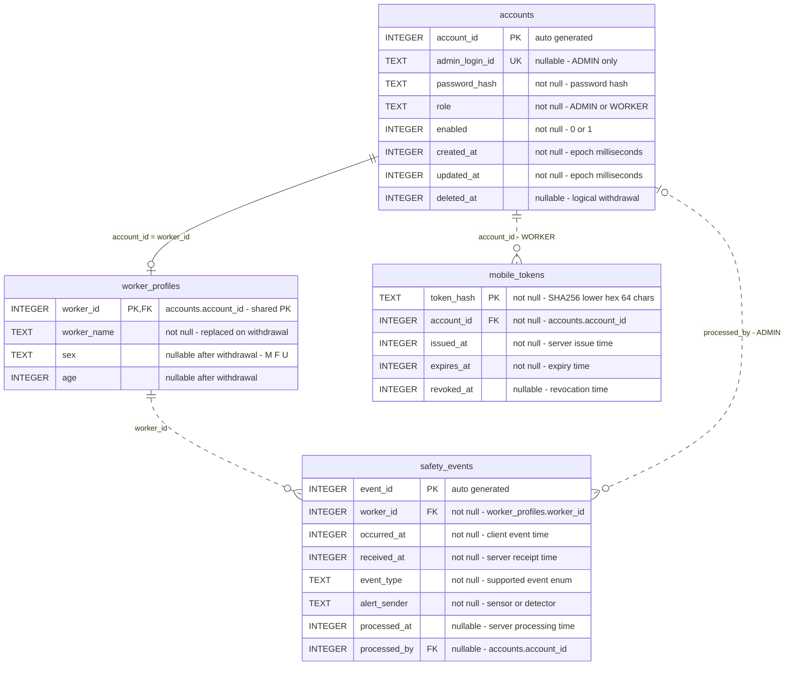

# Spring Boot 기반 작업자 안전 모니터링 서버 최종 구현 지시서

작성일: 2026-11-01 (Asia/Seoul)

## 1. 구현 목표와 적용 범위

**현재 저장소를 분석한 뒤 이 문서를 기준으로 실제 동작하는 작업자 안전 모니터링 서버를 구현하라.** 기존 프로젝트를 재생성하지 말고 필요한 업무 코드·설정·화면·테스트·문서를 추가하라.

이 서버는 Android 앱의 작업자 인증·개인정보·위험 이벤트 등록을 처리하고, 관리자 웹에서 작업자 계정과 위험 이벤트를 관리한다. Android 앱은 HTTPS REST API와 Bearer Token을, 관리자 브라우저는 Thymeleaf 화면과 세션 인증을 사용한다. 업무 로직은 Spring Boot Service, 데이터 접근은 JPA Repository, 저장소는 SQLite로 구성한다.

이 문서는 기존 수정 계획에 DB ER 다이어그램과 구체적인 구현 제약을 통합한 최종 지시서다. 이전 첨부문 없이도 이 문서만으로 구현할 수 있어야 한다. 아래의 요구사항을 이미 구현되거나 검증된 동작으로 해석하지 말라. 구현 대상은 서버·관리자 웹·DB·테스트·Docker 배포 준비·문서이며 Android 앱 자체는 포함하지 않는다.

SQLite 적용은 **단일 서버 인스턴스에서 이벤트를 저장하는 초기 버전**을 전제로 한다. 작업자 수, 초당 이벤트 수, 요구되는 알림 지연은 제공되지 않았으므로 운영 규모 적합성은 아직 확정할 수 없다. 다중 인스턴스나 지속적인 대량 쓰기가 필요하면 DB 선정을 먼저 재검토한다. 폴링 화면을 제공하는 초기 범위에는 실시간 알림 전달 보장이 포함되지 않는다.

## 2. 현재 프로젝트 기준과 선행 점검

아래는 2026-11-01 검토 당시 확인한 상태다. 구현 시작 시 변경 여부를 다시 확인하고 기존 사용자 변경을 보존하라.

| 항목 | 확인 결과 | 근거 |
| --- | --- | --- |
| 프로젝트 | `org.example:workersafety_server:0.0.1-SNAPSHOT` | `pom.xml` |
| Spring Boot | `4.1.2` | `pom.xml:8` |
| Java 빌드 대상 | `17` | `pom.xml:30` |
| IntelliJ SDK 설정 | `temurin-17`, `JDK_17` | `.idea/misc.xml` |
| 기본 패키지 | `org.example.workersafety_server` | 애플리케이션 및 테스트 소스 |
| 시작 클래스 | `WorkersafetyServerApplication` | `src/main/java/org/example/workersafety_server/WorkersafetyServerApplication.java` |
| 기존 의존성 | JPA, Security, Thymeleaf, Validation, Web MVC, Thymeleaf Security extras, DevTools, Lombok 및 기능별 테스트 starter | `pom.xml` |
| DB 관련 누락 | SQLite JDBC, community dialect 의존성 및 datasource 설정이 없음 | `pom.xml`, `application.properties` |
| 애플리케이션 설정 | `spring.application.name`만 존재 | `src/main/resources/application.properties` |
| 업무 코드·화면 | Controller, Entity, Repository, Service, 관리자 템플릿이 없음 | `src` 파일 목록 |
| 테스트 | `contextLoads()` 한 개 | `src/test/java/org/example/workersafety_server/WorkersafetyServerApplicationTests.java` |
| 문서 | README는 `# server` 한 줄 | `README.md` |
| Maven Wrapper | Wrapper `3.3.4`, Maven 배포 URL은 `3.10.0` | `.mvn/wrapper/maven-wrapper.properties` |
| Git 작업 상태 | 검토 시작 전에 `README.md`가 미추적 상태 | `git status --short` |

이전 검토의 실행 확인에는 다음 제한이 있었다. 구현 단계 0에서 다시 점검하라.

- `java -version`: 현재 도구 프로세스의 PATH에서 `java`를 찾지 못했다.
- `JAVA_HOME`: Temurin 17 경로가 지정되어 있지만, 해당 실행 파일 경로 조회는 접근 거부되었다. JDK가 설치되지 않았다고 단정할 수 없다.
- `.\mvnw.cmd --version` 및 `.\mvnw.cmd clean verify`: `Cannot index into a null array`와 `Cannot start maven from wrapper`로 종료되었다. Maven 시작 이전의 실패이므로 컴파일·테스트 결과가 아니다. Wrapper 파일 결함인지 실행 환경 문제인지도 확정하지 않았다.
- `target` 디렉터리에 산출물 디렉터리가 존재하지만, 이를 현재 코드의 빌드 성공 근거로 사용하지 않았다.

정적 검토상 JPA starter가 있는데 JDBC 드라이버와 datasource가 없어 DB 자동 구성도 보완해야 한다. 실제 부팅 오류는 위 실행 제한 때문에 재현하지 못했다.

## 3. 확정 기술 기준

| 항목 | 구현 기준 |
| --- | --- |
| Java | **17 유지**. 기본 구현에 Java 업그레이드를 포함하지 않음 |
| Framework | Spring Boot `4.1.2`와 해당 BOM 유지 |
| Build | 기존 Maven Wrapper 사용, Gradle 전환 금지 |
| HTTP | Spring MVC REST API, JSON DTO |
| DB / ORM | SQLite JDBC + Spring Data JPA + Hibernate community SQLiteDialect |
| Security | Spring Security, 작업자 Opaque Bearer Token, 관리자 세션 인증 |
| View | Thymeleaf + 기본 HTML/CSS/JavaScript |
| Test | Boot BOM이 관리하는 JUnit Jupiter, 기존 기능별 테스트 starter |
| Deployment | Docker, 단일 애플리케이션 인스턴스, SQLite 영구 볼륨 |

Boot 4.1.2는 Java 17을 지원하므로 Java 21로의 전환은 이 기능 구현의 기술적 선행 조건이 아니다. [Spring Boot 시스템 요구사항](https://docs.spring.io/spring-boot/system-requirements.html)

이후 사용자가 Java 21을 필수로 지정하면 POM·IDE·실행 JDK·Docker를 함께 변경하고 재검증하라. 기존 `thymeleaf-extras-springsecurity6`는 현재 BOM의 관리 대상이므로 유지하고 실제 렌더링을 검증하라. 이름만으로 충돌을 단정하거나 임의의 `springsecurity7` artifact로 교체하지 말라. Boot 3용 Security API·테스트 import를 그대로 복사하지 말고 현재 버전에 맞춰 작성하라.

Boot 4.1.2 공식 관리 목록에는 Spring Security `7.1.2`, Hibernate core/community dialects `7.4.13.Final`, JUnit Jupiter `6.0.3`, SQLite JDBC `3.53.4.0`, `thymeleaf-extras-springsecurity6` `3.1.5.RELEASE`가 포함된다. 이 값들은 공식 BOM 기준이며, 로컬 dependency tree를 실행해 확인한 결과는 아니다. 아래 신규 의존성도 개별 버전을 덮어쓰지 않고 BOM을 따른다. [관리 의존성 목록](https://docs.spring.io/spring-boot/appendix/dependency-versions/coordinates.html)

## 4. 유지할 구조와 구현 범위

- Spring Boot `4.1.2`, Maven Wrapper, 프로젝트명과 기본 패키지를 유지한다.
- 기존 `spring-boot-starter-webmvc`와 기능별 테스트 starter를 유지한다. 기능 구현을 위해 일괄 재구성하지 않는다.
- `org.example.workersafety_server` 아래에 `config`, `controller/api`, `controller/web`, `service`, `repository`, `entity`, `dto`, `security`, `exception`을 필요할 때 추가한다. 빈 계층이나 단일 구현만 있는 불필요한 인터페이스는 만들지 않는다.
- Controller는 DTO를 입출력하고 Service를 호출한다. 업무 트랜잭션은 Service, 영속성 접근은 Repository가 담당한다. API와 웹은 동일한 Service를 사용한다.
- 관리자 화면은 `templates/admin/{login,dashboard,events,workers}.html`과 최소 CSS·JavaScript로 구현한다.
- Android 앱, 위치·날씨 수집, WebSocket, 외부 인증 서버, Redis, 메시지 브로커는 구현 범위에 추가하지 않는다. 제외 기능의 가짜 API도 만들지 않는다.

## 5. DB와 데이터 생명주기

### 5.1 의존성과 연결

추가할 의존성은 다음 두 개다.

- `org.xerial:sqlite-jdbc` — 런타임 JDBC 드라이버.
- `org.hibernate.orm:hibernate-community-dialects` — `org.hibernate.community.dialect.SQLiteDialect` 제공.

SQLite dialect는 Hibernate core에 내장된 dialect가 아닌 community 지원 항목이다. 따라서 실제 SQLite를 사용한 통합 테스트를 DB 단계의 합격 조건으로 둔다. [Hibernate dialect 문서](https://docs.hibernate.org/stable/core/dialect/)

연결·초기화 기준:

- 개발 DB 기본 경로는 `./data/workersafety.db`, 배포 경로는 `/data/workersafety.db`로 한다. `SQLITE_DB_PATH`로 재지정한다. 연결 전에 상위 디렉터리의 존재와 쓰기 권한을 확인하고 필요하면 생성한다.
- 모든 물리 연결에서 `foreign_keys=ON`, `busy_timeout=5000`을 적용하고 실제 값을 확인한다. FK 활성화는 업무 트랜잭션 시작 전에 수행한다. [SQLite PRAGMA 문서](https://sqlite.org/pragma.html)
- WAL 모드를 초기화 시 설정하고 반환값을 확인한다. Hikari pool의 초기 최대 연결 수는 2로 두고 실제 쓰기 경쟁 테스트로 검증한다. 연결 수를 늘리는 것을 쓰기 성능 해결책으로 사용하지 않는다.
- 초기 스키마는 명시적 `schema.sql`로 생성하고 `spring.sql.init.mode=always`, `ddl-auto=none`을 사용한다. `CREATE TABLE/INDEX IF NOT EXISTS`는 최초 생성만 담당하며 기존 테이블 변경을 대신하지 않는다. 이후 스키마 변경은 버전별 SQL과 백업·적용 순서를 함께 관리한다.
- 반복 기동 시 데이터가 유지되어야 한다. 개발·배포 설정에 `create`, `create-drop`, 무조건적인 데이터 삭제 SQL을 사용하지 않는다.
- DB 잠금 대기가 끝나도 쓰기에 실패하면 일관된 `503 DATABASE_BUSY`를 반환한다. 무제한 재시도나 성공으로 위장한 응답을 하지 않는다.
- Java 시간은 `Instant`, DB 시간은 UTC epoch milliseconds `INTEGER`로 통일한다. JPA 변환 및 밀리초 정밀도 왕복 테스트를 작성한다. API는 UTC ISO 8601, 관리자 화면은 `Asia/Seoul`로 표시한다.
- `spring.jpa.open-in-view=false`로 두고 필요한 DTO 변환과 연관 조회를 서비스 트랜잭션 안에서 끝낸다.

WAL은 읽기·쓰기 병행에 도움이 되지만 동시 writer는 하나이며, 네트워크 파일시스템에 제약이 있다. 초기 배포는 한 호스트의 단일 애플리케이션 인스턴스로 제한한다. [SQLite WAL 문서](https://www.sqlite.org/wal.html)

### 5.2 테이블과 ER 다이어그램

| 테이블 | 필드 및 관계 |
| --- | --- |
| `accounts` | `account_id` 자동 생성 정수 PK, `admin_login_id` nullable UNIQUE, `password_hash`, `role`, `enabled`, `created_at`, `updated_at`, `deleted_at` nullable |
| `worker_profiles` | `worker_id` PK/FK → `accounts.account_id`, `worker_name`, `sex`, `age`; 공유 PK는 JPA `@MapsId`로 연결 |
| `safety_events` | `event_id` 자동 생성 정수 PK, `worker_id` FK → `worker_profiles.worker_id`, `occurred_at`, `received_at`, `event_type`, `alert_sender`, `processed_at` nullable, `processed_by` nullable FK → `accounts.account_id` |
| `mobile_tokens` | `token_hash` PK/UNIQUE, `account_id` FK → `accounts.account_id`, `issued_at`, `expires_at`, `revoked_at` nullable |

#### ER 다이어그램

다음은 구현할 SQLite 테이블의 물리 관계다. 시간 필드는 모두 UTC epoch milliseconds를 저장하는 `INTEGER`다. nullable 여부는 필드 주석과 아래 제약을 따른다.



[Mermaid ER 표기 기준](https://mermaid.js.org/syntax/entityRelationshipDiagram.html)에 따라 실선은 공유 PK의 식별 관계, 점선은 비식별 관계를 나타낸다. `PK`는 기본 키, `FK`는 외래 키, `UK`는 유일 키다. `o|` 또는 `|o`는 0~1개, `o{`는 0개 이상이다. 테이블·필드·관계를 이 다이어그램과 실제 DDL·JPA 매핑·README에서 일치시켜라.

| 관계 | 카디널리티 | 업무 제약 |
| --- | --- | --- |
| 계정 → 작업자 프로필 | 전체 계정 기준 1 : 0..1 | WORKER는 생성 트랜잭션 완료 시 정확히 1개, ADMIN은 0개. 프로필은 반드시 하나의 계정에 소속 |
| 작업자 프로필 → 이벤트 | 1 : 0..N | 모든 이벤트는 정확히 하나의 작업자 프로필 참조. 탈퇴해도 프로필 행 유지 |
| 계정 → 모바일 토큰 | 1 : 0..N | 모든 토큰은 정확히 하나의 WORKER 계정 참조. ADMIN에게 모바일 토큰 발급 금지 |
| 관리자 계정 → 처리 이벤트 | 0..1 : 0..N | 이벤트의 처리자는 미처리 시 0명, 처리 완료 시 1명. 한 관리자는 여러 이벤트 처리 가능 |

FK는 참조 행의 존재를 보장한다. `WORKER`/`ADMIN` 역할 같은 테이블 간 업무 제약은 FK만으로 보장되지 않으므로 Service에서 검증하고 통합 테스트하라. 모든 FK의 물리 삭제 정책은 `ON DELETE RESTRICT`로 두고 탈퇴에 cascade 삭제를 사용하지 말라. 관리자 물리 삭제 API도 만들지 말라.

#### DDL·JPA 매핑 규칙

- `accounts.account_id`, `safety_events.event_id`는 SQLite `INTEGER PRIMARY KEY AUTOINCREMENT`와 JPA `GenerationType.IDENTITY`를 사용하고 실제 ID 발급을 검증한다. `worker_profiles.worker_id`에는 별도의 자동 생성을 설정하지 않는다.
- 다이어그램에서 nullable이라고 표시한 필드 외에는 `NOT NULL`을 명시한다. 프로필 이름은 탈퇴 후에도 `탈퇴한 작업자`라는 값으로 유지한다.
- `accounts`에는 역할 enum, `enabled IN (0, 1)`, ADMIN의 필수 `admin_login_id`와 WORKER의 NULL `admin_login_id`, 탈퇴 시 `enabled=0` 조건을 CHECK로 반영한다.
- `admin_login_id`는 UNIQUE를 적용하고 앞뒤 공백 제거 후 검사한다. 비밀번호에는 임의의 trim 또는 대소문자 변환을 적용하지 않는다.
- 프로필의 성별은 NULL 또는 `M/F/U`, 나이는 NULL 또는 0~150 범위다. 활성 작업자 생성·수정 API에서는 NULL을 허용하지 않는다.
- `mobile_tokens.token_hash`는 SHA-256의 소문자 16진 문자열 64자로 저장하고 `expires_at > issued_at`을 보장한다. 토큰 해시는 API로 반환하지 않는다.
- `processed_by`는 `Account`에 대한 선택적 `@ManyToOne`, `worker_id`는 필수 `WorkerProfile` 연관이다. `Account`와 `WorkerProfile`은 `@OneToOne` 및 `@MapsId`로 연결한다. 불필요한 양방향 컬렉션은 추가하지 않는다.
- 이벤트의 처리 상태는 별도 boolean과 중복 저장하지 않고 `processed_at`의 NULL 여부로 판단한다. 처리 일관성은 다음 CHECK로 보장한다.

```sql
CHECK (
    (processed_at IS NULL AND processed_by IS NULL)
    OR
    (processed_at IS NOT NULL AND processed_by IS NOT NULL)
)
```

세부 규칙:

- Java ID 타입은 `Long`, SQLite 자동 생성 PK의 DDL은 `INTEGER PRIMARY KEY` 계열로 맞추고 JPA 식별자 발급을 검증한다. 다른 DB의 sequence 설정을 복사하지 않는다.
- 관리자만 `admin_login_id`를 가지며, 작업자는 `workerId = account_id`로 로그인한다. 관리자와 작업자는 내부 ID 공간을 공유한다. 관리자 로그인 ID를 PK에 수동 삽입하지 않는다.
- `role`은 `ADMIN`/`WORKER`, 이벤트 종류는 `FALL_DETECTED`, `DANGER_ZONE_APPROACH`, `ABNORMAL_VITAL`을 문자열 enum으로 저장한다. DB CHECK와 입력 검증을 일치시킨다. 다른 역할 계정의 잘못된 연관은 Service에서도 차단한다.
- `processed_at`과 `processed_by`는 둘 다 NULL이거나 둘 다 값이 있어야 한다. 생성 요청에서는 처리 필드를 받지 않는다.
- 조회용 초기 인덱스는 이벤트의 `(occurred_at, event_id)`, `(worker_id, occurred_at, event_id)`, `(processed_at, occurred_at, event_id)` 및 토큰의 `account_id`, `expires_at`에 둔다. 추가 인덱스는 쿼리 확인 후 결정한다.
- 이름·성별·나이는 생성 시 필수지만, 탈퇴 후 제거할 수 있도록 프로필 컬럼의 null 허용 범위를 설계한다. API의 생성·수정 검증과 DB의 탈퇴 상태를 구분한다.

### 5.3 탈퇴와 보존

초기 버전의 `DELETE /api/worker/me`는 영구적인 논리 탈퇴다.

1. 현재 비밀번호를 확인한다.
2. `enabled=false`, `deleted_at=서버 시각`을 기록한다.
3. 프로필 이름을 `탈퇴한 작업자`로 대체하고 성별·나이를 제거한다. 기존 비밀번호 해시는 새 무작위 값의 해시로 대체한다.
4. 모든 모바일 토큰을 폐기한다.
5. 프로필 행과 이벤트 행은 유지하여 외래 키와 처리 이력을 보존한다. 탈퇴 계정의 비밀번호 초기화는 거부하고 재활성화 기능은 제공하지 않는다.

이 과정은 한 트랜잭션으로 수행한다. 관리자 이벤트 조회는 탈퇴 프로필도 처리할 수 있어야 한다. 잔존 ID와 이벤트 때문에 완전한 익명화나 물리 삭제를 보장한다고 설명하지 않는다. 초기 개발 버전은 이벤트 자동 삭제를 구현하지 않으며, 실제 운영 전 보존 기간과 최종 파기 범위를 운영 주체가 정해 문서에 반영해야 한다.

## 6. 인증·인가 정책

### 6.1 경로별 정책

| 경로 | 인증 방식 | 권한·CSRF·실패 처리 |
| --- | --- | --- |
| `POST /api/worker/auth/login` | 공개 JSON 로그인 | 작업자 계정만 토큰 발급, 실패 `401` |
| 그 밖의 `/api/worker/**` | Bearer Token 전용 | `ROLE_WORKER`, STATELESS, 이 체인에서 CSRF 제외, 미인증 JSON `401` |
| `/api/admin/**` | 관리자 세션 | `ROLE_ADMIN`, 변경 요청 CSRF 필요, JSON `401/403` |
| `/admin/login` | 공개 로그인 폼 | 로그인 POST에도 CSRF 유지, 입력 필드는 `adminId`, `password` |
| 나머지 `/admin/**` | 관리자 세션 | `ROLE_ADMIN`, 변경 요청 CSRF 필요, 미로그인 시 로그인 화면 이동 |
| `GET /health`, 필요한 정적 파일 | 공개 | 최소 상태·정적 리소스만 제공 |
| 기타 경로 | 명시적 제한 | 보안 체인 누락으로 공개되지 않게 기본 차단 |

`@Order(1)` 모바일 체인과 나머지를 담당하는 세션 체인으로 분리한다. 관리자 API와 웹은 세션을 공유하되, API 오류 응답은 HTML 리다이렉트 대신 JSON으로 분기한다. 기본 HTTP Basic은 활성화하지 않는다. 모바일 Bearer 필터는 해당 체인에만 등록하여 중복 실행을 피한다.

다중 체인은 `securityMatcher`와 순서로 선택되므로 로그인 처리 URL까지 올바른 체인에 포함되는지 확인한다. 세션 기반 관리자 API를 `/api/**`라는 이유로 CSRF 예외 처리하지 않는다. [Spring Security Java 설정](https://docs.spring.io/spring-security/reference/servlet/configuration/java.html), [CSRF 문서](https://docs.spring.io/spring-security/reference/servlet/exploits/csrf.html)

### 6.2 비밀번호·토큰·초기 관리자

- 비밀번호는 복호화 가능한 암호문이 아닌 `PasswordEncoder`의 단방향 해시로 저장한다.
- 토큰은 `SecureRandom` 32바이트 이상을 URL-safe 문자열로 인코딩한다. 원문은 발급 응답에만 포함하고 DB에는 SHA-256 해시를 저장한다.
- 토큰 기본 수명은 `PT12H`로 한다. 갱신 토큰은 만들지 않고 만료 시 재로그인한다. 다중 기기 로그인은 허용하며, 로그아웃은 현재 토큰만 폐기한다.
- 매 Bearer 요청에서 토큰 해시·만료·폐기 여부와 계정 `enabled`·`deleted_at`·역할을 확인한다. 토큰 검사 때마다 DB 쓰기를 하지 않는다.
- 비밀번호 변경·관리자 초기화·탈퇴는 관련 계정 변경과 전체 토큰 폐기를 같은 트랜잭션에서 처리한다. 로그인 토큰 발급과의 경합으로 폐기 대상 토큰이 살아남지 않도록 계정 변경 충돌을 처리하고 검증한다. 이미 처리 중인 요청까지 소급 취소한다고 보장하지 않는다.
- 최초 관리자 생성에는 `ADMIN_LOGIN_ID`, `ADMIN_INITIAL_PASSWORD`를 사용한다. 관리자 행이 하나라도 있으면 재생성·비밀번호 덮어쓰기를 하지 않는다. 관리자 부재 시 필수 설정이 없거나, 기존 관리자 모두가 비활성 상태라면 명확한 오류로 기동을 중단한다.
- 비밀번호·토큰·Authorization 헤더·임시 비밀번호를 로그에 남기지 않는다. 작업자 생성·초기화 응답에는 `Cache-Control: no-store`를 적용한다.
- 임시 비밀번호의 평문은 생성·초기화 요청 응답에서만 반환한다. 응답을 잃어버렸다면 재조회하지 않고 다시 초기화한다.

## 7. API 계약

아래 경로와 입출력을 구현한다. 각 행은 기능의 완료 판정 기준이며 모든 JSON API는 DTO를 사용한다.

| 메서드·경로 | 입력·동작 | 성공 응답 |
| --- | --- | --- |
| `POST /api/worker/auth/login` | `workerId`, `password`; ADMIN·비활성·탈퇴 계정 거부 | `200`: `accessToken`, `tokenType=Bearer`, `expiresAt` |
| `POST /api/worker/auth/logout` | 현재 Bearer 토큰 폐기 | `204` |
| `POST /api/worker/events` | `time`, `eventType`, `alertSender`; workerId는 인증 주체에서 결정 | `201`: 생성 이벤트 DTO |
| `PATCH /api/worker/me` | `workerName`, `sex`, `age`의 부분 수정 | `200`: 수정된 프로필 DTO |
| `PATCH /api/worker/me/password` | `currentPassword`, `newPassword`; 성공 후 현재 토큰 포함 전체 폐기 | `204`, 이후 재로그인 |
| `DELETE /api/worker/me` | JSON의 `currentPassword`로 재인증 후 논리 탈퇴 | `204` |
| `GET /api/admin/events` | 아래의 이벤트 필터·페이지 규칙 | `200`: 이벤트 페이지 DTO |
| `GET /api/admin/events/{eventId}` | 단일 이벤트 및 작업자·처리자 정보 | `200`, 없으면 `404` |
| `PATCH /api/admin/events/{eventId}/process` | 세션 관리자 ID와 서버 시각으로 최초 처리 | `200`: 최종 이벤트 DTO |
| `POST /api/admin/workers` | `workerName`, `sex`, `age` | `201`: `workerId`, `temporaryPassword`, Location 헤더 |
| `GET /api/admin/workers` | `page`, `size` | `200`: 작업자 페이지 DTO |
| `GET /api/admin/workers/{workerId}` | 관리자 계정 ID는 작업자로 반환하지 않음 | `200`: `workerId`, `workerName`, `sex`, `age`, `enabled` |
| `POST /api/admin/workers/{workerId}/reset-password` | 작업자 비밀번호 교체 및 전체 토큰 폐기 | `200`: `workerId`, `temporaryPassword` |
| `GET /health` | 최소 DB 연결 확인, 내부 설정·경로는 숨김 | 정상 `200 {"status":"UP"}`, 장애 `503 {"status":"DOWN"}` |

추가 계약과 비핵심 기본값:

- 이벤트 목록 필터는 `processed`(생략=전체, true=완료, false=미처리), `workerId`, `eventType`을 조합한다. 정렬은 `occurred_at DESC, event_id DESC`로 고정한다.
- 두 목록의 `page` 기본값은 0, `size`는 20, 허용 범위는 1~100이다. 페이지 응답은 `items`, `page`, `size`, `totalElements`, `totalPages`로 고정하고 JPA Page 객체를 그대로 직렬화하지 않는다.
- `time`은 이벤트 등록 요청의 필드명이며 내부 `occurred_at`에 매핑한다. `received_at`은 서버가 기록한다. 오프라인 전송을 고려해 과거 시각 자체를 오류로 처리하지 않는다.
- `PATCH /me`는 생략 필드를 유지하고 명시적 null, 빈 변경 요청은 `400`으로 거부한다. 생성과 부분 수정 DTO의 필수값 검증을 구분한다.
- 초기 검증값은 이름 1~50자(공백 이름 불가), 성별 `M/F/U`(U=미지정), 나이 정수 0~150, 발신 주체 1~100자다. 알려지지 않은 이벤트 타입·잘못된 날짜 형식·음수 ID·잘못된 페이지 값은 `400`이다.
- 비밀번호 초기 정책은 12~64자다. BCrypt 사용 시 UTF-8 72바이트 제한도 함께 검증하여 조용한 잘림을 허용하지 않는다. 임시 비밀번호도 같은 정책을 만족한다.
- 잘못된 현재 비밀번호는 일반적인 재인증 실패 `401`, 로그인 실패는 계정 존재·비활성 여부를 구분하지 않는 `401`로 응답한다.
- 오류 본문은 `code`, `message` 형식으로 통일하고 Validation의 필드 정보는 필요할 때만 추가한다. Security 필터 오류에도 동일한 JSON 형식을 사용한다.
- 응답에는 비밀번호 해시·토큰 해시·내부 예외를 포함하지 않는다. DTO에 필요한 필드만 선언한다.

### 이벤트 처리의 원자성

`UPDATE safety_events SET processed_at=?, processed_by=? WHERE event_id=? AND processed_at IS NULL` 형태로 처리한다. 영향 행 수가 0이면 이벤트 부재와 이미 처리됨을 구분해 조회한다. 이미 처리됐다면 기존 처리자와 시각을 그대로 `200`으로 반환한다. 처리 권한 검사와 조건부 갱신은 Service에서 수행하며 SQLite에 행 수준 잠금이 있다고 가정하지 않는다.

## 8. 관리자 웹

- `GET /admin/login`은 로그인 화면, `POST /admin/login`은 폼 인증, `POST /admin/logout`은 세션 무효화와 로그아웃을 처리한다. 로그인 성공 시 `/admin/dashboard`로 이동한다.
- `/admin/dashboard`: 활성 작업자 수, 전체 이벤트 수, 미처리 이벤트 수, 최근 이벤트를 표시한다. 탈퇴 작업자는 활성 인원에 포함하지 않는다.
- `/admin/events`: 필터·페이지 이동·처리 버튼·처리 시각을 제공한다. 기본 5초 폴링으로 현재 필터와 페이지를 갱신한다. 중첩 요청을 피하고 실패 또는 세션 만료를 화면에 알린다.
- `/admin/workers`: 목록·상세·생성·비밀번호 초기화를 제공한다. 탈퇴 계정은 비활성으로 표시한다. 임시 비밀번호를 한 번 보여주고 재조회나 브라우저 저장 기능을 제공하지 않는다.
- 폼에는 CSRF hidden 필드를, fetch 변경 요청에는 CSRF 헤더를 넣는다. Thymeleaf는 사용자 입력을 이스케이프하여 표시한다.
- 웹과 API에서 서로 다른 계정 생성·처리 로직을 중복 구현하지 않는다.

## 9. 실행·배포 설정

| 환경변수 | 기본값·정책 |
| --- | --- |
| `ADMIN_LOGIN_ID` | 초기 관리자 부재 시 필수. 내부 자동 생성 PK와 별개 |
| `ADMIN_INITIAL_PASSWORD` | 초기 관리자 부재 시 필수. 로그·예제에 실제 값 저장 금지 |
| `SQLITE_DB_PATH` | 로컬 `./data/workersafety.db`, 컨테이너 `/data/workersafety.db` |
| `SERVER_PORT` | `8080` |
| `MOBILE_TOKEN_TTL` | `PT12H` |
| `SPRING_PROFILES_ACTIVE` | `local` 또는 `prod`; 테스트는 별도 설정 |

- 기본 `local` 프로필은 프로젝트 작업 디렉터리의 `.env`를 UTF-8 Java Properties로 선택적으로 읽는다. 이 동작은 `application-local.properties`의 Config Data import로 구현하며 추가 dotenv 의존성을 넣지 않는다. `.env` 없이도 OS·IntelliJ 환경변수 주입으로 실행할 수 있다.
- `prod`와 `test`는 로컬 `.env`를 자동 import하지 않는다. Docker Compose는 자체 `.env` 보간으로 값을 컨테이너 환경변수에 전달한다. 파일 값보다 OS 환경변수·Java 시스템 속성·명령행 값이 우선한다.
- `.env.example`은 IntelliJ 로컬 실행과 Compose에서 쓸 변수 예시다. Java Properties 문법(인용부호·`export` 접두사 없이 `KEY=value`)과 Compose 보간의 특수문자 차이를 README에 설명한다. `.env` 및 비밀값은 Git·이미지·로그에 넣지 않는다.
- DB 디렉터리·환경파일·비밀값을 Git에서 제외한다. WAL·SHM 파일까지 포함하도록 DB 저장 디렉터리 전체를 제외하고 `.dockerignore`에도 반영한다.
- Dockerfile은 선택한 Java 버전의 빌드·실행 이미지를 일치시킨다. DevTools를 배포 실행에 포함하지 않고, 비루트 사용자에게 `/data` 쓰기 권한을 준다.
- Compose가 필요하면 단일 앱 서비스와 `/data` 영구 볼륨만 둔다. Spring Boot Docker Compose Support는 추가하지 않는다.
- 운영에서는 HTTPS, Secure·HttpOnly 세션 쿠키를 적용한다. 프록시 헤더는 신뢰할 수 있는 프록시 경로에 맞춰 설정한다. 로컬 HTTP에서도 동작하도록 프로필을 구분한다.
- 정상 종료·재시작 후 데이터 유지, 백업 파일 복원 후 이벤트 조회를 확인한다. WAL 사용 중 실행 중인 DB 본체 파일만 단순 복사하는 백업은 채택하지 않는다.

## 10. 단계별 실행 계획과 합격 조건

| 단계 | 수행 작업 | 검증·합격 조건 |
| --- | --- | --- |
| 0. 빌드 환경 기준선 | JDK 17 경로·실행 권한·PATH, Wrapper 실패 원인 확인; Maven dependency tree 확인 | Wrapper 버전 출력 및 의존성 해석 성공. 현 단계의 환경 실패와 이후 코드 실패를 구분해 기록 |
| 1. 최소 DB 부팅 | 두 의존성 추가, datasource·dialect·schema.sql, Account/Role/Profile/Event/Token Entity와 Repository | 격리 SQLite로 contextLoads 통과; ID 발급·FK 차단·시간 왕복·재시작 영속성 확인 |
| 2. 보안 기반 | PasswordEncoder, 초기 관리자, 두 SecurityFilterChain, 세션 로그인·모바일 토큰 | 초기 계정 생성·재기동 무변경·설정 누락 실패, API 401/403, 세션/Bearer 분리 및 CSRF 검증 |
| 3. 작업자 계정·모바일 흐름 | 관리자 작업자 생성·조회, 작업자 로그인·로그아웃, 개인정보·비밀번호·탈퇴·이벤트 등록 | 생성→로그인→등록의 실제 흐름, 다른 사용자 ID 조작 차단, 만료·폐기·비활성 계정 인증 거부 |
| 4. 관리자 이벤트·초기화 | 목록 필터·페이지·상세·조건부 처리, 작업자 비밀번호 초기화 | 정렬·필터 조합, 중복·동시 처리의 최초 값 보존, 비밀번호 초기화 후 모든 기존 토큰 거부 |
| 5. Thymeleaf 화면 | 로그인·Dashboard·이벤트·작업자 화면, 폴링 및 CSRF 전달 | 실제 폼 로그인부터 계정 생성·이벤트 처리·로그아웃까지 화면과 JSON API 연동 확인 |
| 6. 배포·인수 검증 | 환경변수 문서, Dockerfile, 필요한 Compose, README API 명세 | clean verify 성공, 패키징 실행·health, 컨테이너 재생성 후 데이터 유지 및 백업 복구 확인 |

각 단계에서 확인되지 않은 실패를 다음 단계의 기능으로 덮지 않는다. 구현 중 `contextLoads`가 실패하면 원인을 해결하며, 이를 피하기 위해 JPA·Security 자동 구성을 업무 실행 경로에서 끄거나 테스트를 삭제하지 않는다.

### 필수 테스트

다음 15개 항목을 모두 자동화 테스트에 포함하라.

1. 격리 DB로 애플리케이션 기동 및 Health Check 성공, DB 장애 시 health 실패 응답.
2. SQLite 저장·조회·자동 ID·외래 키 차단·시간 왕복·재기동 데이터 유지.
3. 최초 관리자 생성, 기존 관리자 및 비밀번호 보존, 필수 설정 누락 처리.
4. 관리자에 의한 작업자 Account·Profile 동시 생성과 임시 비밀번호 반환.
5. 작업자 로그인 성공·실패, ADMIN·비활성·탈퇴 계정 로그인 거부.
6. 토큰 로그아웃·만료·폐기 및 현재 토큰만 로그아웃되는지 확인.
7. 인증된 작업자의 이벤트 등록 및 초기 미처리 상태 확인.
8. 관리자의 이벤트 목록·상세·필터 조합·페이지·정렬 검증.
9. 관리자 이벤트 처리, 반복 처리 및 동시 처리의 최초 처리자·시각 보존.
10. 개인정보 부분 수정, 비밀번호 변경·관리자 초기화 및 전체 토큰 폐기.
11. 현재 비밀번호 재인증을 통한 탈퇴, 개인정보 처리, 이벤트 참조 유지.
12. 작업자에 의한 관리자 API 접근 차단 및 인증 주체의 ID 사용.
13. 미인증 API 요청의 JSON 401, 권한 부족의 403, 잘못된 입력의 400.
14. 실제 관리자 폼 로그인·Thymeleaf 페이지 렌더링·로그아웃·세션 만료 처리.
15. 관리자 로그인 폼·일반 폼·JSON 변경 API의 CSRF 보호 및 정상 토큰 요청 허용.

테스트 환경과 추가 경계 조건:

- 실제 임시 SQLite 파일을 사용하고 경로는 테스트별로 주입한다. 개발 DB를 재사용하거나 초기화하지 않는다. DB 차이를 숨기는 H2 대체는 사용하지 않는다.
- JUnit Jupiter와 기존 Boot 테스트 starter를 사용한다. 시간을 제어하는 테스트는 `Clock`을 주입하고 실제 대기로 토큰 만료를 검증하지 않는다.
- 추가 보안 경계 조건을 검증한다: 관리자 계정의 모바일 로그인 거부, 관리자 세션만으로 모바일 API 접근 거부, Bearer만으로 관리자 API 접근 거부, 만료·폐기 토큰 및 계정 비활성화, CSRF 없는 관리자 API 변경 거부.
- 비밀번호 변경·초기화·탈퇴 후 다른 기기의 토큰도 거부되는지 검증한다. 로그인 발급과 무효화 경합도 확인한다.
- 이벤트 두 개 이상의 동시 처리 요청은 독립 연결·트랜잭션으로 검증한다. 모두 종료된 뒤 최초 처리자·시각의 일관성을 확인한다.
- 탈퇴 후 이벤트 FK 유지·프로필 표시·로그인 거부·비밀번호 초기화 거부, 잘못된 PATCH와 날짜·필터 입력을 검증한다.
- Maven 기본 테스트 규칙에 포함되는 `*Tests` 이름을 사용한다. `*IT`를 사용한다면 Failsafe를 설정해 `verify`가 실제로 실행하도록 한다. 실행된 테스트 수와 결과를 보고한다.
- 최종 명령은 Windows에서 `.\mvnw.cmd clean verify`, 다른 환경에서 `./mvnw clean verify`다. 추가로 패키징된 서버와 가능한 Docker 환경에서 핵심 흐름을 확인한다. 실행하지 못한 항목은 사유와 함께 별도 표기한다.

## 11. 구현 시 제출물

최종 제출물은 동작하는 서버, SQLite 스키마·Entity·Repository, 모바일·관리자 API, 인증·인가, 관리자 화면, 자동화 테스트, Docker 설정 및 README다. README에는 전체 API의 요청·응답 예시, 오류 코드, 환경변수 주입, 최초 관리자 생성, 논리 탈퇴의 의미, SQLite 단일 인스턴스 제약, 백업·복구, 실행·테스트 방법을 포함한다.

구현 결과 보고에서는 실제 성공한 빌드·테스트·실행 결과와 미검증 항목을 구분한다. 계획된 동작을 이미 구현된 결과처럼 보고하지 말라. 환경 제한으로 수행하지 못한 검증은 실제 오류와 재현 명령을 함께 남겨라.

## 12. 구현 에이전트 작업 규칙

1. 구현 전 `pom.xml`, 소스, 설정, 로컬 지침, Git 변경 상태를 다시 확인하고 간단한 단계별 작업 계획을 제시하라.
2. Java 17·Boot 4.1.2·Maven·패키지명·프로젝트명을 유지하라. 환경 문제를 이유로 프로젝트를 재생성하거나 무관한 라이브러리를 업그레이드하지 말라.
3. 기존 사용자 변경과 미추적 파일을 보존하고 요청에 필요한 파일만 수정하라. 테스트 실행을 위해 기존 개발 DB를 초기화하거나 삭제하지 말라.
4. 비핵심 세부사항은 이 문서의 기본값을 사용하고 추가 가정은 README에 기록하라. 인증·권한·데이터 보존에 영향을 주는 요구가 충돌하면 해당 충돌을 명시하라.
5. 핵심 기능에 TODO, 더미 응답, 비어 있는 메서드를 남기지 말라. Controller에서 직접 DB를 조작하거나 Entity를 응답으로 반환하지 말라.
6. 인증·인가·CSRF 검증을 테스트 통과 목적으로 끄지 말라. 실패한 테스트를 삭제하거나 실행 대상에서 제외하지 말라.
7. 평문 비밀번호·인증 토큰·DB 파일·실제 환경변수를 소스, 로그, Git, Docker 이미지에 포함하지 말라. 테스트용 자격증명은 운영값과 독립적으로 생성하라.
8. 계획을 설명하는 것으로 구현 작업을 완료했다고 보고하지 말라. 파일 수정, Maven 검증, 가능한 실행 점검을 수행하고 실제 결과를 기록하라.

## 13. 완료 명령과 최종 보고

Windows에서 다음 명령을 실행하라.

```powershell
.\mvnw.cmd clean verify
```

다른 환경에서는 다음 명령을 사용하라.

```bash
./mvnw clean verify
```

오류가 있으면 원인을 해결한 뒤 필요한 검증을 다시 수행하라. 패키징된 서버를 실행하여 health와 관리자 초기 생성 → 작업자 생성 → 모바일 로그인 → 이벤트 등록 → 관리자 조회·처리 → 토큰 폐기의 핵심 흐름을 확인하라. 사용 가능한 Docker 환경에서는 영구 볼륨 유지와 백업 복구도 확인하라.

최종 구현 보고에는 다음을 포함하라.

- 실제 구현한 기능과 생성·수정한 주요 파일.
- 실제 DB 스키마 및 이 문서와 일치하는 ERD.
- 전체 API와 주요 요청·응답 예시를 담은 README 위치.
- 실행한 빌드·테스트 명령, 테스트 수와 결과, 서버 실행 확인 결과.
- 미구현 기능 또는 수행하지 못한 검증과 그 구체적인 사유.
- SQLite 운영 전제, 논리 탈퇴·이력 보존 정책 및 운영 전에 확정할 부하·보존 기간.

**이 문서를 구현 작업의 기준으로 삼아 현재 저장소에서 단계 0부터 진행하라. 검증되지 않은 동작을 성공했다고 주장하지 말고 실제 코드와 테스트 결과로 완료 여부를 입증하라.**
